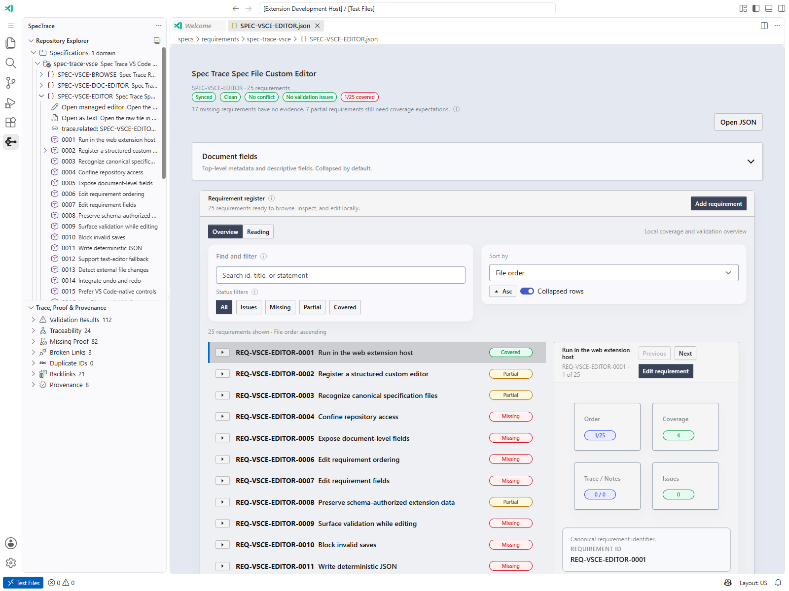
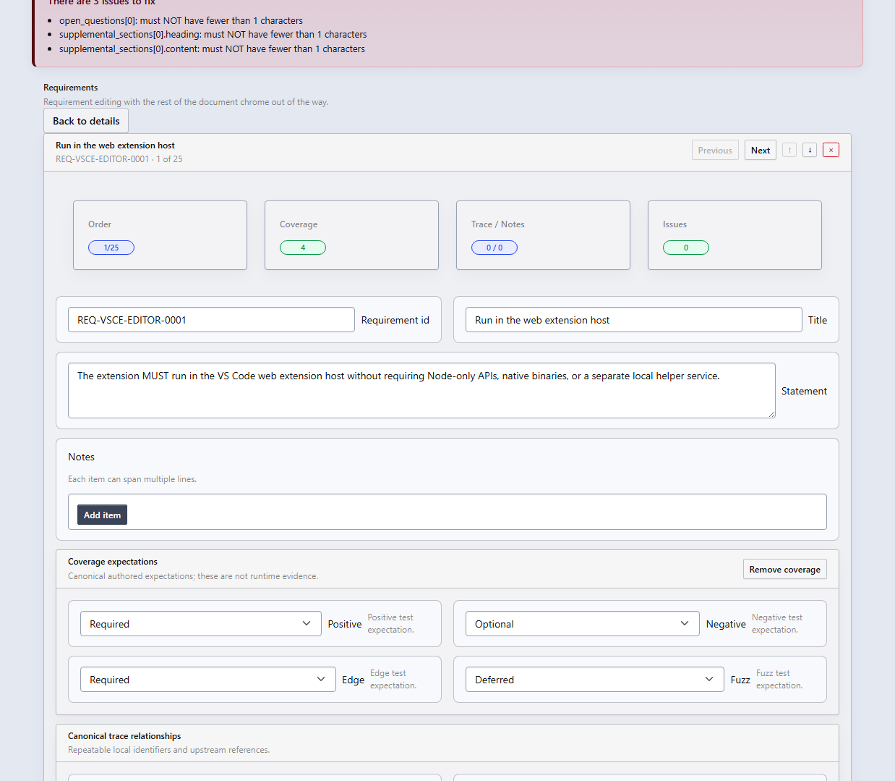

# SpecTrace for VS Code

SpecTrace for VS Code is a genuine web extension for working inside a repository that stores canonical SpecTrace artifacts. The same portable browsing, validation, traceability, and editing core runs in desktop VS Code and browser hosts. Desktop VS Code adds an optional, trust-gated Workbench integration.

The extension provides four primary surfaces:

- A repository explorer that groups SpecTrace artifacts by category and domain.
- A local-only custom editor for specification JSON files, with a manager-inspired requirement register, persistent inspector, and focused typed editing.
- A browser-safe trace, proof, backlink, broken-link, duplicate-ID, and provenance view derived directly from canonical repository files.
- An optional desktop boundary for deterministic Workbench doctor, validation, quality, and proof-health commands.

## Support level

This extension is published as a preview. Treat editing and repository-management behavior as a preview API, while canonical SpecTrace files remain the source of truth and can always be edited as JSON.

## Features

### Repository explorer

- Adds a dedicated `SpecTrace` activity bar container.
- Groups artifacts into:
  - Specifications
  - Architectural Views
  - Work Items
  - Verification Documents
- Expands specification files into individual requirement nodes.
- Opens specification JSON files in the custom editor.
- Reveals a specific requirement directly from the tree.
- Creates specification, architecture, work-item, and verification artifacts from canonical templates.
- Plans repository repair in a read-only JSON preview before any scaffold files are created.

### Trace, proof, and provenance

- Validates canonical IDs and references without a companion executable.
- Shows resolved trace links and reverse backlinks.
- Groups missing verification proof, unresolved references, and duplicate IDs.
- Summarizes explicit `source_refs`, `source_references`, `provenance`, and `upstream_refs` metadata without treating absence as invented provenance.
- Opens the affected canonical file and selects the relevant ID.
- Uses `vscode.workspace.fs` and bounded discovery (2,000 files per canonical family) so it remains useful in a web extension host.

### Local requirements workspace

- Opens `specs/requirements/**/*.json` files in a custom editor.
- Uses the shared `@incursa/ui-kit` surface rather than ad hoc HTML.
- Starts in a browse-first requirement register with a persistent selected-requirement inspector.
- Provides Overview and Reading views without adding view state to canonical JSON.
- Supports search plus `All`, `Issues`, `Missing`, `Partial`, and `Covered` filters.
- Provides typed canonical coverage controls and repeatable trace-reference editors.
- Preserves requirement, coverage, trace, and `x_...` extension fields during local round trips.
- Opens a requirement into a focused editing screen while keeping the standard JSON editor available.
- Supports previous and next requirement navigation while staying in the detail screen.
- Places document details before the long requirements surface.
- Stacks the inspector at narrow editor widths without horizontal page scrolling.
- Persists browse and edit state in the webview during reloads.
- Continues to use VS Code save, dirty, undo/redo, revert, backup, validation, and external-conflict behavior.

### Optional desktop Workbench integration

Desktop commands are hidden in web hosts and are not required for canonical browsing or editing. In a trusted local workspace the extension can discover Workbench from:

1. `specTrace.workbench.executable`
2. `.workbench/bin/workbench.exe`
3. `.workbench/tools/workbench.exe`
4. `PATH`

The extension exposes only allowlisted deterministic operations:

- Workbench Doctor
- Workbench Validate, with direct navigation from structured findings
- Workbench Show Quality
- Workbench Show Proof Health
- Workbench Sync Quality Evidence, always preceded by a dry-run preview and explicit confirmation

Every invocation uses argument arrays with `shell: false`, structured JSON output, cancellation, a configurable timeout (30 seconds by default, hard-capped at 120 seconds), and a combined output limit (1 MiB by default, hard-capped at 5 MiB). No Codex, AI generation, voice, GitHub mutation, worktree, or credential-management commands are registered.

## Screenshots

### Traceability workspace



### Requirement index


### Filtered requirement browse view


### Focused requirement detail



## Workspace Expectations

The extension assumes a SpecTrace-style repository layout. The explorer and custom editor use paths like:

```text
specs/
  requirements/<domain>/*.json
  architecture/<domain>/*.md
  work-items/<domain>/*.md
  verification/<domain>/*.md
```

## Development

Install dependencies:

```bash
npm install
```

Run the main verification pass:

```bash
npm run release:check
```

Run only the browser smoke coverage for the custom editor UI:

```bash
npm run test:webview
```

Run the extension in a browser-hosted development session:

```bash
npm run run-in-browser
```

`npm run release:check` runs the web-host and webview tests, builds both browser and desktop entry points, verifies brand assets, creates and inspects the VSIX, and writes a SHA-256 sidecar under `artifacts/packages/`.

## Release Notes

See [CHANGELOG.md](CHANGELOG.md).

## License And Brand Assets

The extension code and documentation are licensed under Apache-2.0. The SpecTrace name and the files listed in [`BRAND-ASSET-LICENSE.md`](BRAND-ASSET-LICENSE.md) are separate brand assets governed by that policy and [`TRADEMARKS.md`](TRADEMARKS.md); they are not licensed under Apache-2.0.
