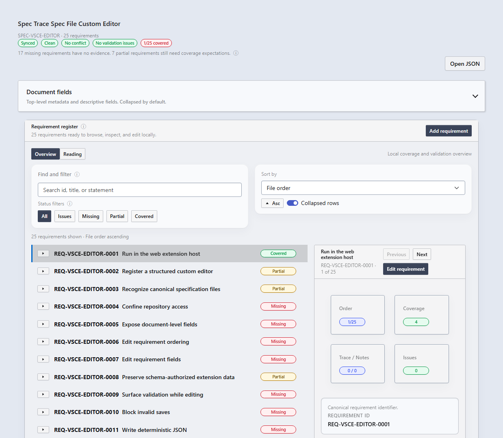

# SpecTrace for VS Code

SpecTrace for VS Code is a web extension for working inside a repository that stores canonical SpecTrace artifacts.

The current preview focuses on two high-value surfaces:

- A repository explorer that groups SpecTrace artifacts by category and domain.
- A dense custom editor for specification JSON files, optimized for scanning many requirements and opening one requirement into a focused editing screen.

## Current Preview

This extension is still in preview while its editing and repository-management surfaces continue to mature.

## Features

### Repository explorer

- Adds a dedicated `SpecTrace` activity bar container.
- Groups artifacts into:
  - Specifications
  - Architectural Views
  - Work Items
  - Verification Documents
- Expands specification files into individual requirement nodes.
- Opens specification JSON files in the custom editor.
- Reveals a specific requirement directly from the tree.

### Dense specification editor

- Opens `specs/requirements/**/*.json` files in a custom editor.
- Uses the shared `@incursa/ui-kit` surface rather than ad hoc HTML.
- Starts in a browse-first requirement index instead of a noisy card grid.
- Supports search plus `All`, `Issues`, `Missing`, `Partial`, and `Covered` filters.
- Opens a requirement into a focused detail screen for editing.
- Supports previous and next requirement navigation while staying in the detail screen.
- Persists browse and edit state in the webview during reloads.

## Screenshots

### Requirement index



### Filtered requirement browse view


### Focused requirement detail


## Workspace Expectations

The extension assumes a SpecTrace-style repository layout. The current explorer and custom editor are built around paths like:

```text
specs/
  requirements/<domain>/*.json
  architecture/<domain>/*.md
  work-items/<domain>/*.md
  verification/<domain>/*.md
```

## Development

Install dependencies:

```bash
npm install
```

Run the main verification pass:

```bash
npm test
```

Run only the browser smoke coverage for the custom editor UI:

```bash
npm run test:webview
```

Run the extension in a browser-hosted development session:

```bash
npm run run-in-browser
```

## Preview Status

- The extension is still marked as preview while the surface matures.

## Release Notes

See [CHANGELOG.md](CHANGELOG.md).

## License And Brand Assets

The extension code and documentation are licensed under Apache-2.0. The SpecTrace name and the files listed in [`BRAND-ASSET-LICENSE.md`](BRAND-ASSET-LICENSE.md) are separate brand assets governed by that policy and [`TRADEMARKS.md`](TRADEMARKS.md); they are not licensed under Apache-2.0.
